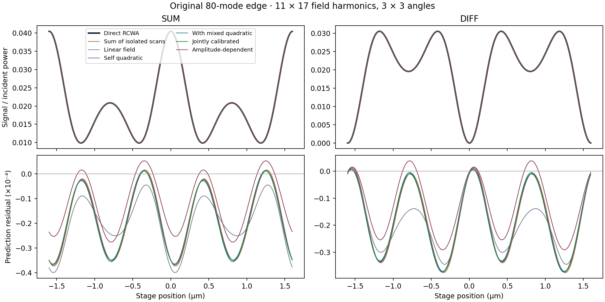
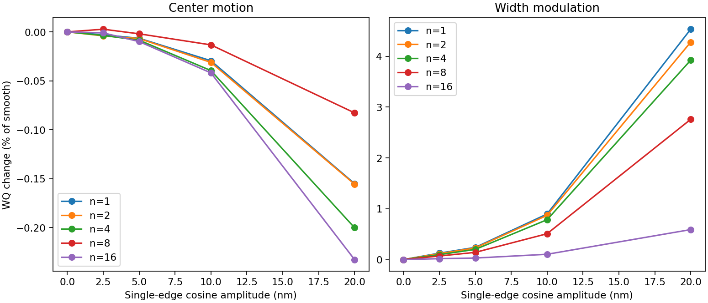
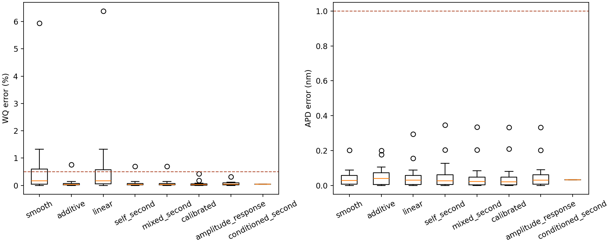
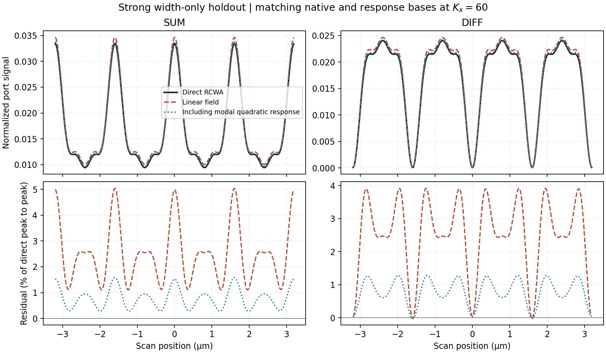
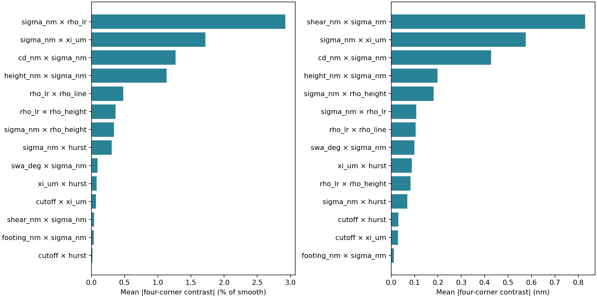
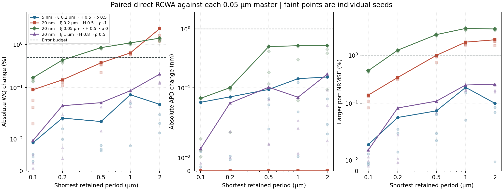
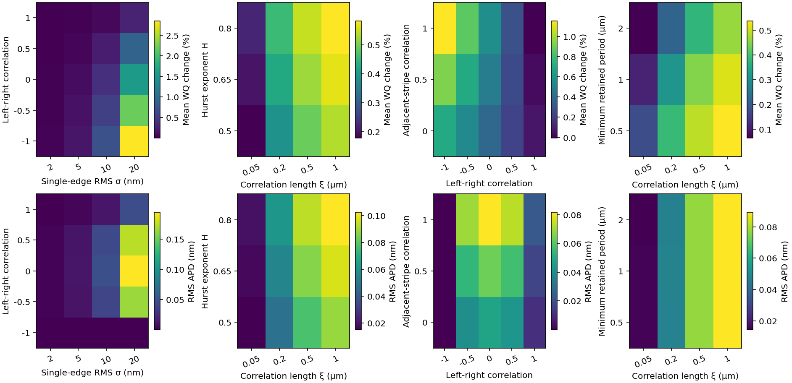

# 随机边缘的 RCWA 响应曲线实算

16 个随机留出轮廓的同设置预测验收已完成。物理精度状态由直接 RCWA 的独立收敛对照判断。

基准为 3.2 μm 节距、1.6 μm CD、300 nm 深度、643 nm 和 38 μm 高斯照明。流程和公式见 [计算口径与复现步骤](README.md)。 正入射数值检查与聚焦光斑试验用独立标签。

## 原始随机轮廓
复现了原图的 481 个采样点，使用完整 80 个正频分量。第一档比较以单纹 3.2 × 8 μm 原胞、跨纹 11 个场谐波和沿纹 17 个场谐波为基准。 表中误差为响应预测减去同一几何的直接 RCWA。 [原图边缘表](analysis/original_edge_coordinates.csv)

原图设定的单边总体 RMS 为 5 nm。这次 seed 实现得到左边缘 5.149 nm 和右边缘 3.905 nm。带宽实验保留同一 master 的低频幅值和相位。

直接解的归一 WQ 为 **1.0005213**，APD 为 **-0.079 nm**。

| 响应模型 | WQ 误差 % | APD 误差 nm | SUM NRMSE % | DIFF NRMSE % |
|---|---:|---:|---:|---:|
| 平滑基准 | -0.052 | 0.079 | 0.111 | 0.097 |
| 单项扫描相加 | 0.006 | 0.077 | 0.073 | 0.072 |
| 一阶复场 | -0.052 | 0.069 | 0.072 | 0.071 |
| 加自身二阶 | 0.006 | 0.067 | 0.072 | 0.071 |
| 加混合二阶 | 0.006 | 0.059 | 0.072 | 0.071 |
| 联合训练校准 | 0.009 | 0.059 | 0.073 | 0.071 |
| 使用单模幅值曲线 | 0.023 | 0.055 | 0.051 | 0.054 |

SUM 和 DIFF 的上排曲线复用同一条几何。下排放大响应模型相对直接解的偏差。平滑基准也通过此轮廓的工程门槛，模型的提升要结合较强扰动和独立留出上的结果。 [原始扫描点](analysis/original_scans.csv)

直接把这条边缘移位 ±100 nm 后，去除该轮廓自身的模板偏差，位移恢复误差最大为 2.43e-06 nm。这是光路坐标与定位算法的校验。 [坐标校验](analysis/coordinate_validation.json)

### 原轮廓换用加密直接背景后的对照

| 模型 | WQ 误差 % | APD 误差 nm | SUM NRMSE % | DIFF NRMSE % |
|---|---:|---:|---:|---:|
| 加密平滑背景 | 0.007 | 0.065 | 0.042 | 0.043 |
| 平滑背景加冻结响应 | 0.055 | 0.046 | 0.139 | 0.125 |

前面的同档评分之外，这次以加密的平滑 RCWA 作背景，把冻结的粗糙度复场增量插值到 25 个入射角。两种预测均达标。原图扰动很弱，应用响应后 APD 误差降低，WQ 和波形误差增加。 [加密背景对照](analysis/original_fine_transfer.csv)

对原轮廓的扫描，投影到平滑模板位移导数所得 APD 与完整拟合的差最大为 0.0004 nm。投影去掉了可由增益和背景解释的分量。 [位置线性化数据](analysis/direct_kpis.csv)

## 单模式和现有较强扰动对照

上轮保留的 20 nm 单边 RMS 纯线宽工况，在本次 38 μm 光束和同一筛选场基底上，直接 WQ 为 1.050770。该算例检查响应在明显大于原图扰动时的误差。

| 响应模型 | WQ 误差 % | APD 误差 nm | SUM NRMSE % | DIFF NRMSE % |
|---|---:|---:|---:|---:|
| 平滑基准 | -5.077 | 0.000 | 3.993 | 5.001 |
| 单项扫描相加 | -0.621 | -0.000 | 1.181 | 1.124 |
| 一阶复场 | -5.297 | 0.000 | 2.351 | 2.373 |
| 加自身二阶 | -0.555 | -0.000 | 1.620 | 1.503 |
| 加混合二阶 | -0.551 | -0.000 | 1.628 | 1.501 |
| 联合训练校准 | -0.330 | 0.000 | 1.638 | 1.498 |
| 使用单模幅值曲线 | -0.498 | -0.000 | 1.404 | 1.291 |

单模图使用直接改变余弦幅度的结果。横轴是单边位移峰值。两面板分别固定中心摆动或线宽起伏，曲线标签为 8 μm 主周期中的沿纹频率。同一 RMS 的频带出现不同的 WQ 响应，预测应读入实际 Fourier 系数。

## 留出轮廓上的预测能力

按几何哈希检查 16 条独立留出。冻结库记录了 272 条核函数来源和 54 个校准工况，与留出的重合几何数为 0。 [校准输入审计](analysis/coordinate_validation.json)

| 模型 | KPI 两项通过 | 同时通过波形 | WQ 绝对误差中位 % | APD 绝对误差中位 nm |
|---|---:|---:|---:|---:|
| smooth | 11/16 | 11/16 | 0.171 | 0.028 |
| additive | 15/16 | 15/16 | 0.031 | 0.039 |
| linear | 11/16 | 11/16 | 0.174 | 0.031 |
| self_second | 15/16 | 15/16 | 0.031 | 0.026 |
| mixed_second | 15/16 | 15/16 | 0.031 | 0.023 |
| calibrated | 16/16 | 15/16 | 0.030 | 0.021 |
| amplitude_response | 16/16 | 15/16 | 0.041 | 0.030 |
| conditioned_second | 1/1 | 1/1 | 0.045 | 0.032 |

箱图中的横线为 WQ 0.5% 和 APD 1 nm 的预算，结合表中两项都通过的计数看模型的使用范围。每条具体扫描的数据保存在盲测曲线目录。

逐样本表同时记录孔径相关阶的复场误差与粗糙度增量场误差。单项扫描相加直接输出两路信号，其复场列为空。

[逐样本误差](analysis/heldout_prediction.csv) · [盲测扫描文件](analysis/heldout/)

### 未通过的留出轮廓
冻结校准模型在此样本的粗场谐波基准上超过波形门槛。下面对同一几何增加场谐波，以检查直接解本身的变化。此追加结果独立于原 16 例评分。

| RCWA 设置 | 直接 WQ 相对平滑变化 % | APD nm |
|---|---:|---:|
| k10x4_d2x10_a3_h4 | 5.9782 | 0.000 |
| k10x4_d4x20_a3_h4 | 5.9466 | -0.000 |
| k10x8_d4x20_a3_h4 | 5.9102 | 0.000 |
| k20x4_d2x10_a3_h4 | -0.0739 | 0.000 |
| k20x4_d4x20_a3_h4 | -0.0763 | 0.000 |
| k20x8_d2x10_a3_h4 | -0.0934 | -0.000 |
| k20x8_d4x20_a3_h4 | -0.0981 | -0.000 |
| k30x4_d4x20_a3_h4 | -3.1507 | 0.000 |
| k40x4_d4x20_a3_h4 | -1.8508 | 0.000 |
| k40x8_d4x20_a3_h4 | -1.8124 | 0.000 |
| k50x4_d4x20_a3_h4 | -1.6420 | 0.000 |
| k60x4_d4x20_a3_h4 | -1.5737 | 0.000 |

比较同一沿纹截断与几何采样下的跨纹加密。若直接 WQ 的变化超过预算，工程物理验收按加密后的直接解变化判断。 [直接解与参考](analysis/direct_kpis.csv)

### 细基底的单模复核
20 阶跨纹库覆盖了 9 组重复直接解所需的所有单项复场响应，其中 9 组通过 WQ、APD 和两路波形判据。 [细基底单模表](analysis/fine_single_mode_preview.csv) · [细基底扫描文件](analysis/fine_validation/)

粗档波形超限样本在细库和细直接解的匹配对照中，WQ 绝对误差最大为 0.221%，SUM NRMSE 最大为 0.289%。每条观察以对应的细档为比较对象。 [细基底单模表](analysis/fine_single_mode_preview.csv)

四层高度起伏留出在 $(K_x,K_z)=(20,16)$ 已独立完成 9 个入射角。直接 WQ 为 0.9999288，APD 为 -0.095 nm。名义高度的单模二阶预测在同档给出 0.002% 的 WQ 误差、0.096 nm 的 APD 误差，较大波形 NRMSE 为 0.019%。该几何的平滑基准也通过工程判据。

### 强线宽样本的 $K_x=60$ 响应
该几何的正频宽度系数全部有原生单模响应。下表使用该算例所需的复场自身二阶项。 [高谐波线宽验证](analysis/strong_width_high_validation.csv) · [直接解与预测的扫描](analysis/strong_width_high_scans.npz)

| 模型 | WQ 误差 % | APD 误差 nm | SUM NRMSE % | DIFF NRMSE % |
|---|---:|---:|---:|---:|
| 一阶复场 | 1.565 | -0.000 | 2.730 | 2.749 |
| 加自身二阶 | 0.475 | 0.000 | 0.858 | 0.874 |

下排按直接扫描的峰谷幅值放大误差。加入二阶项后，两路残差的 RMS 都从约 2.7% 降到约 0.9%。

### 高度相关性单独建库的对照
对 $ρ_h=0.5$ 的留出轮廓，用 40 个独立原生单模响应表达顶底共同与差异分量。这项复核比较高度条件模型及冻结标称模型在同一直接解上的表现。 [高度条件验证](analysis/height_conditioned_validation.csv)

| 响应模型 | WQ 误差 % | APD 误差 nm | SUM NRMSE % | DIFF NRMSE % |
|---|---:|---:|---:|---:|
| 平滑基准 | -0.151 | -0.026 | 0.161 | 0.197 |
| 加自身二阶 | -0.029 | -0.035 | 0.115 | 0.115 |
| 联合训练校准 | -0.023 | -0.032 | 0.118 | 0.118 |
| 含高度或截面的条件模型 | -0.045 | -0.032 | 0.129 | 0.138 |

## 交互差与删减判断

| 组合 | KPI | 对照数 | 平均绝对交互差 | 交互大于两项主效应的次数 |
|---|---|---:|---:|---:|
| sigma_nm × rho_lr | wq | 4 | 2.926% | 0/4 |
| sigma_nm × xi_um | wq | 4 | 1.720% | 4/4 |
| cd_nm × sigma_nm | wq_nominal | 2 | 1.269% | 0/2 |
| height_nm × sigma_nm | wq_nominal | 2 | 1.131% | 0/2 |
| rho_lr × rho_line | wq | 4 | 0.478% | 0/4 |
| shear_nm × sigma_nm | apd_nominal_nm | 2 | 0.830 nm | 0/2 |
| rho_lr × rho_height | wq | 4 | 0.362% | 1/4 |
| sigma_nm × rho_height | wq | 4 | 0.339% | 0/4 |

图中对相同数值档的四角差按 seed 汇总。四角差用 $K_{11}-K_{10}-K_{01}+K_{00}$ 计算，比较的是一种因素改变后，另一种因素的效应增加了多少。 逐组保留了两项单独效应以及符号。 [原生四角差](analysis/factor_interactions.csv)

同一参数组合在同一谐波、光栅和照明设置下按独立 seed 汇总。APD 同时报告带符号均值和 RMS。 [交互差的 seed 统计](analysis/factor_seed_summary.csv)

选择筛选中最强的参数交互，在两档第三因素下用完整八角组重复。第三阶交互取两档的二因素交互差。 [第三因素原生对照](analysis/third_factor_interactions.csv) · [逐角 KPI](analysis/third_factor_native_kpis.csv) · [种子不确定度](analysis/third_factor_seed_summary.csv)

| 参数组合 | 完整八角组 | 最大绝对 WQ 交互差 % | 最大绝对 APD 交互差 nm |
|---|---:|---:|---:|
| cd_nm × sigma_nm × rho_lr | 4 | 4.446 | 0.035 |
| sigma_nm × rho_lr × xi_um | 4 | 5.210 | 0.382 |
| sigma_nm × xi_um × cutoff | 4 | 0.148 | 0.278 |

交互差本身可逐轴比较 12 组，其中 7 组超出 WQ 0.1% 或 APD 0.2 nm 的数值余量。逐行数据保留加密前后的交互差。 [交互差数值收敛](analysis/factor_interaction_convergence.csv)

sigma_nm × rho_lr 在 seed 1427 的 WQ 交互差，随 ku 加密从 -3.259% 变为 0.109%。这个对照直接影响该交互项的工程分级。

63 个确定性双模式组合已有同设置的直接比较。最大的 WQ 四角差是 0.096%，最大的 APD 四角差是 0.181 nm。表中同时给出把一阶复场合成后再进干涉模型的残差，用于区分电磁与光学混合。 [确定性模式交互](analysis/deterministic_interactions.csv)

### 原轮廓删去 0.1–0.5 μm 频带

| RCWA 设置 | WQ 配对差 % | APD 配对差 nm | SUM NRMSE % | DIFF NRMSE % |
|---|---:|---:|---:|---:|
| k10x12_d2x5_a3_h4 | 0.003 | 0.033 | 0.012 | 0.012 |
| k10x12_d2x5_a5_h4 | 0.003 | 0.033 | 0.013 | 0.013 |
| k15x16_d2x5_a1_h4 | 0.012 | 0.024 | 0.041 | 0.041 |
| k15x24_d2x5_a1_h4 | 0.012 | 0.035 | 0.039 | 0.039 |
| k20x16_d2x5_a1_h4 | 0.006 | 0.040 | 0.032 | 0.032 |
| k5x8_d4x5_a3_h4 | 0.016 | 0.140 | 0.034 | 0.034 |
| k9x12_d2x5_a3_h4 | -0.166 | 0.006 | 0.416 | 0.416 |

同档下使用相同光栅采样和同一个 80 模式 master。从各档的配对差判断截断误差，绝对 WQ 的截断敏感性另读收敛表。
[原生带宽配对](analysis/band_pairs_native.csv)

### 随机轮廓的截止对照
两种强度均以同一 seed 的 0.05 μm 最短周期输入为参照。保留的低频系数与相位相同，表内保留两路扫描的误差。

| 随机边缘 | 最短保留周期 μm | WQ 配对差 % | APD 配对差 nm | 较大一路 NRMSE % |
|---|---:|---:|---:|---:|
| 5 nm RMS · seed 1427 | 0.5 | 0.007 | -0.066 | 0.029 |
| 5 nm RMS · seed 1427 | 1.0 | 0.008 | 0.011 | 0.048 |
| 5 nm RMS · seed 2441 | 0.5 | 0.008 | 0.094 | 0.035 |
| 5 nm RMS · seed 2441 | 1.0 | -0.067 | 0.123 | 0.211 |
| 20 nm RMS 纯线宽 · seed 1427 | 0.5 | -0.342 | -0.000 | 0.926 |
| 20 nm RMS 纯线宽 · seed 1427 | 1.0 | -0.602 | 0.000 | 1.751 |
| 20 nm RMS 纯线宽 · seed 2441 | 0.5 | -0.375 | 0.000 | 0.924 |
| 20 nm RMS 纯线宽 · seed 2441 | 1.0 | -0.592 | -0.000 | 1.623 |
| 20 nm RMS 纯线宽 · seed 1427 | 0.5 | -0.332 | -0.000 | 0.918 |
| 20 nm RMS 纯线宽 · seed 1427 | 1.0 | -0.775 | -0.000 | 1.386 |
| 20 nm RMS 纯线宽 · seed 1427 | 0.5 | 0.058 | -0.000 | 0.259 |
| 20 nm RMS 纯线宽 · seed 1427 | 1.0 | 0.107 | 0.000 | 0.264 |

频带判断使用对应光栅和场谐波档的实测配对差。全部输入、采样及扫描对照保存在逐例表。 [原生带宽数据](analysis/band_pairs_native.csv)

按目标 PSD 对各频率的 WQ 二阶系数加权。四个设定在保留周期 ≥0.5 μm 时，预测被删频带贡献的平均 WQ 变化为 0.010% 至 0.205%。一阶 APD 方差项和二阶均值另列，实际 APD 验收仍取同 seed 的直接配对。 [单模频率系数](analysis/modal_kpi_frequency_response.csv) · [PSD 加权预测](analysis/band_psd_prediction.csv)

按频带、求解档和统计情景汇总配对差。25 组包含至少两个 seed，表中同时给出均值、标准差、RMS 与均值的 95% t 区间。少量 seed 的范围适用于当前设定下的初步比较。 [频带配对统计](analysis/band_seed_statistics.csv)

| 条件 | 最短周期 μm | 两项 KPI 和波形通过数 | 最大绝对 WQ 差 % | 最大绝对 APD 差 nm | 最大波形 NRMSE % |
|---|---:|---:|---:|---:|---:|
| 5 nm，ξ 0.2 μm | 0.1 | 4/4 | 0.009 | 0.057 | 0.025 |
| 5 nm，ξ 0.2 μm | 0.2 | 4/4 | 0.020 | 0.070 | 0.050 |
| 5 nm，ξ 0.2 μm | 0.5 | 4/4 | 0.016 | 0.094 | 0.069 |
| 5 nm，ξ 0.2 μm | 1.0 | 4/4 | 0.068 | 0.143 | 0.213 |
| 20 nm 纯线宽，ξ 0.2 μm | 0.1 | 4/4 | 0.089 | 0.000 | 0.148 |
| 20 nm 纯线宽，ξ 0.2 μm | 0.2 | 4/4 | 0.150 | 0.000 | 0.343 |
| 20 nm 纯线宽，ξ 0.2 μm | 0.5 | 4/4 | 0.375 | 0.000 | 0.995 |
| 20 nm 纯线宽，ξ 0.2 μm | 1.0 | 0/4 | 0.638 | 0.000 | 1.877 |
| 20 nm，ξ 0.05 μm | 0.1 | 4/4 | 0.170 | 0.066 | 0.478 |
| 20 nm，ξ 0.05 μm | 0.2 | 0/4 | 0.434 | 0.100 | 1.273 |
| 20 nm，ξ 0.05 μm | 0.5 | 0/4 | 0.845 | 0.502 | 2.694 |
| 20 nm，ξ 0.05 μm | 1.0 | 0/4 | 1.088 | 0.519 | 3.623 |
| 20 nm，ξ 1 μm | 0.1 | 4/4 | 0.010 | 0.017 | 0.020 |
| 20 nm，ξ 1 μm | 0.2 | 4/4 | 0.038 | 0.055 | 0.079 |
| 20 nm，ξ 1 μm | 0.5 | 4/4 | 0.045 | 0.102 | 0.110 |
| 20 nm，ξ 1 μm | 1.0 | 4/4 | 0.084 | 0.069 | 0.239 |

下图每个浅色点对应一条边缘，连线为各条件已完成样本中的最大绝对值。三条预算线分别为 WQ 0.5%、APD 1 nm 和两路波形 1%。

11 个可配对的逐轴频带加密对照中，7 个的删频效应和 6 个的两条直接 WQ/APD 同时进入各自的数值余量。逐行列出删频差值及完整与滤波两条几何各自的变化。原生配对表另外给出瞳孔加权的复电场误差和 RSI 重叠系数的差。 [频带配对的逐轴收敛](analysis/band_pair_convergence.csv) · [带宽配对复场和波形](analysis/band_pairs_native.csv)

### 纯线宽边缘的逐轴截止复核
同一条 20 nm RMS 边缘和同一几何光栅，分别增加跨纹和沿纹的场谐波。

| 数值设置 | 最短周期 μm | WQ 配对差 % | APD 配对差 nm | 较大波形 NRMSE % | 工程验收 |
|---|---:|---:|---:|---:|---|
| k10x16_d4x3.125_a3_h4 | 0.5 | -0.332 | -0.000 | 0.918 | 通过 |
| k10x8_d4x3.125_a3_h4 | 0.5 | -0.342 | -0.000 | 0.926 | 通过 |
| k20x8_d4x3.125_a3_h4 | 0.5 | 0.058 | -0.000 | 0.259 | 通过 |
| k10x16_d4x3.125_a3_h4 | 1.0 | -0.775 | -0.000 | 1.386 | 超限 |
| k10x8_d4x3.125_a3_h4 | 1.0 | -0.602 | 0.000 | 1.751 | 超限 |
| k20x8_d4x3.125_a3_h4 | 1.0 | 0.107 | 0.000 | 0.264 | 通过 |

三档工程验收结果与带宽差的逐轴数值收敛分别记录。1 μm 截止结果随跨纹分辨率而变，最终边界取同一几何在更高场基底上的配对。 [该边缘的两轴复算](analysis/band_pair_convergence.csv)

使用 32 组参数和 4 个配对 seed 筛选删项。表中每项记录超出任一 KPI 门槛的例数、90% 经验分位和最不利点。超限或接近门槛的几何用于原生 RCWA 复算。 [预测删减影响](analysis/reduction_model_screen.csv)

筛选模型与同档直接 RCWA 在 12/16 个候选上给出相同的两项 KPI 分类。有 2 个候选由模型判定达标、直接配对实际超限。这里使用预先选出的最坏点和门槛附近点。 [删参筛选的直接检验](analysis/reduction_screen_validation.csv)

最不利点和门槛附近的直接保真对照按样本记录。当前分布为 待收敛 16 例。
[删参直接核验](analysis/reduction_direct_checks.csv) · [每档几何配对](analysis/reduction_pair_details.csv)

短波二阶修正对 110 个同设置频带配对完成了复算，修正前通过 85 个，修正后通过 93 个，其中 8 个由未通过转为通过。 每个判定同时检查 WQ、APD 和两路波形。 [二阶带宽修正](analysis/band_quadratic_correction.csv)

响应曲面的上排记录各组合的平均 WQ 变化，下排记录 RMS APD，因而保留了符号相反的随机位置偏差。颜色来自模型对配对 master 的统计，用于选取需要直接复算的范围。

[单因素变化](analysis/parameter_response_curves.csv) · [两因素响应曲面数据](analysis/joint_parameter_response.csv)

### 截面非理想与粗糙度
CD、刻蚀高度、侧壁角、垂直剪切、底脚和两档粗糙度的直接响应同时保存相对标称轮廓与相对同截面平滑轮廓的 WQ/APD。静态截面误差的绝对贡献与叠加粗糙度后的增量可从对应列读取。 [截面与粗糙度直接曲线](analysis/profile_response_curves.csv)

| 与 5 到 20 nm RMS 的交互 | seed 数 | 最大绝对 WQ 差 % | 最大绝对 APD 差 nm |
|---|---:|---:|---:|
| CD | 2 | 1.575 | 0.603 |
| 刻蚀高度 | 2 | 1.345 | 0.221 |
| 侧壁角 | 2 | 0.147 | 0.175 |
| 垂直剪切 | 2 | 0.071 | 0.901 |
| 底脚 | 2 | 0.038 | 0.020 |

## 长沿纹超胞
24 和 48 μm 周期用同样的 38 μm 光斑及二维瞳孔。入射角块对同一出射波矢的贡献作相干叠加。不同周期分别按相同 PSD 产生轮廓，长度之间的差值用于筛选周期与光斑的影响。

| 沿纹周期 μm | 相关长度 μm | WQ 相对平滑变化 % | APD nm |
|---:|---:|---:|---:|
| 24.0 | 2.0 | 2.664 | -0.738 |
| 48.0 | 2.0 | 0.938 | -2.254 |
| 24.0 | 5.0 | 3.021 | -1.076 |
| 48.0 | 5.0 | 0.720 | -3.201 |

[同设置的原生 KPI](analysis/direct_kpis.csv) · [长超胞瞳孔积分收敛](analysis/optical_long_convergence.csv)

## 数值边界

原轮廓当前共有 11 个可逐轴比较的数值配对，其中 1 个超过预定的 WQ 0.1% 或 APD 0.2 nm 余量。正入射和 38 μm 的对照分别列出，物理频带结论以相应照明的精度为准。 [数值收敛表](analysis/numerical_convergence.csv)

每个直接算例包含复折射率、显式接口、实际场谐波数、同一几何哈希及原生工程。WQ 和 APD 的工程结论限定在对应的波长、几何、照明和数值档。正入射的稳定性检查可支持相位基准校验，完整高斯角谱的数值验收还依赖角采样。 [求解结果](runs/) · [运行状态](analysis/status.json)

原生角表可按入射角逐块求解以降低峰值内存。已用同一三维单模几何验证逐角拼接和整表返回的 56 个结果通道一致。大算例按完整角表组装后进入同一相干光路。 [入射角分批检查](analysis/angular_batch_verification.json)

## 原生求解回执

| 批次 | 已完成 | 计划数 |
|---|---:|---:|
| 单模与幅值 | 132 | 132 |
| 确定性双模式 | 144 | 144 |
| 联合设计参考 | 64 | 64 |
| 原定档留出 | 16 | 16 |
| 随机参数四角 | 144 | 144 |
| 截面与粗糙度 | 50 | 50 |
| 嵌套频带与长超胞 | 102 | 102 |
| 加密锚点 | 31 | 41 |

追加的诊断和数值复核使用附属队列，原生回执保留求解档、物理输入和实际结果。 [冻结设计](queue/contract_a3_ku10_v3.json)

跨纹 $K_x=20$ 的追加留出有 9/10 组完整角谱。下表记录高沿纹截断缺失时已保存的角度回执。

| 留出样本 | 场谐波设置 | 已保存入射角 |
|---|---|---:|
| blind_new_combo_00_s9101 | k20x16_d2x10_a3_h4 | 9/9 |
| blind_new_combo_03_s9151 | k20x16_d2x10_a3_h4 | 0/9 |

